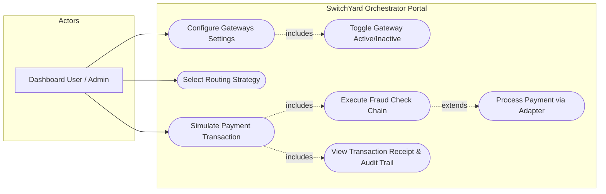
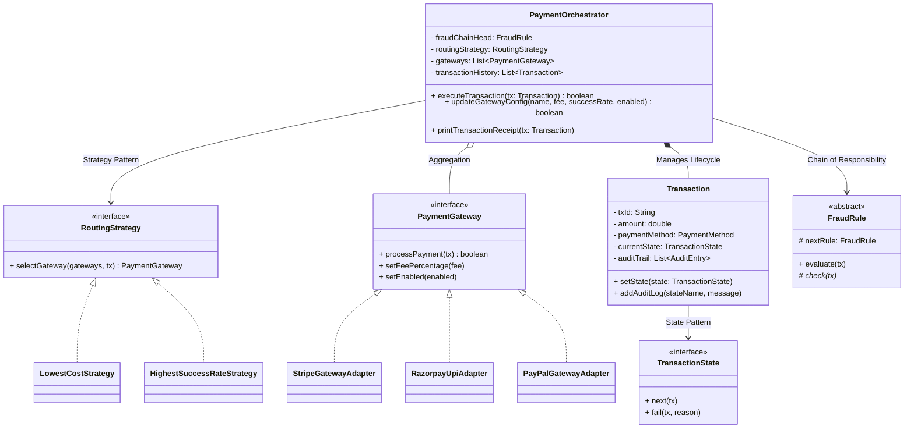
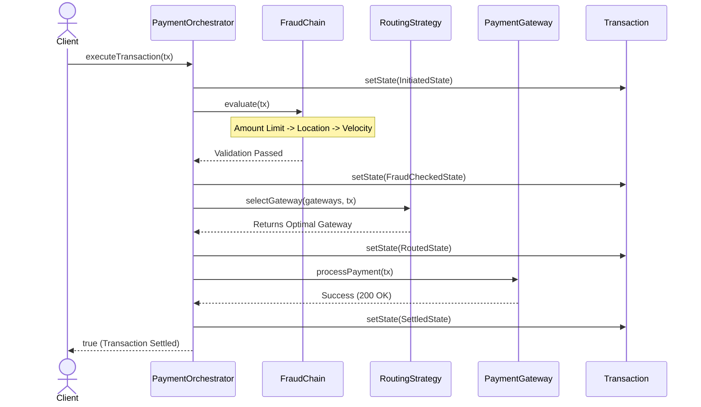

# SwitchYard: OOM Documentation & UML

# System Design Diagrams — Project SwitchYard

## 1. Use Case Diagram

## 2. Class Diagram

## 3. Sequence Diagram

## 4. Activity Diagram

## 5. OOM & Design Pattern Mapping Table
The following table explicitly maps core Object-Oriented methodologies, SOLID principles, and design patterns to the SwitchYard source code.

| Concept / Principle | Implementation in SwitchYard |
|---------------------|------------------------------|
| **Encapsulation** | `Transaction` fields (`amount`, `currentState`) are private. State changes strictly via `setState()`, and audit logs are appended via `addAuditLog()`. |
| **Inheritance** | `AmountLimitFraudRule`, `BlacklistedLocationFraudRule`, and `VelocityCheckFraudRule` inherit the core `evaluate` execution template from the abstract `FraudRule` class. |
| **Polymorphism** | Calling `routingStrategy.selectGateway()` dynamically invokes the logic of either `LowestCostStrategy` or `HighestSuccessRateStrategy` based on the UI dropdown selection at runtime. |
| **Abstraction** | The `PaymentOrchestrator` interacts only with the `PaymentGateway` interface, remaining completely insulated from the underlying complexities of the mock external SDKs. |
| **Composition** | `Transaction` strictly owns its `List<AuditEntry>`. The lifecycle of the audit logs is tied directly to the transaction; destroying the transaction destroys the logs. |
| **Aggregation** | `Transaction` holds references to `Customer` and `Merchant` objects, which exist independently of any single transaction (a customer can have multiple transactions). |
| **SRP (SOLID)** | Single Responsibility Principle: `FraudRule` classes only validate fraud, `RoutingStrategy` classes only evaluate gateway selection, and `TransactionState` classes only handle lifecycle transitions. |
| **OCP (SOLID)** | Open/Closed Principle: To add a new Crypto gateway, developers create a new class implementing `PaymentGateway` and add it to the factory list without altering `PaymentOrchestrator`. |
| **DIP (SOLID)** | Dependency Inversion Principle: `PaymentOrchestrator` depends on abstractions (`RoutingStrategy`, `FraudRule`, `PaymentGateway`) rather than concrete classes, passed in via its constructor. |
| **Strategy Pattern** | Allows hot-swapping between `LowestCostStrategy` and `HighestSuccessRateStrategy` in real-time via the Dashboard UI without stopping the server. |
| **Chain of Responsibility** | `FraudChainFactory` links rules (Amount -> Location -> Velocity). If one rule throws a `FraudDetectedException`, the chain breaks and the transaction is immediately blocked. |
| **Adapter Pattern** | Wraps incompatible third-party SDKs (`RazorpayUpiSDK`) inside standard classes (`RazorpayUpiAdapter`) that conform to the system's `PaymentGateway` contract. |
| **State Pattern** | Manages `Transaction` transitions (`InitiatedState` -> `FraudCheckedState` -> `RoutedState` -> `SettledState`). Calling `.next()` dictates the valid directional flow. |
