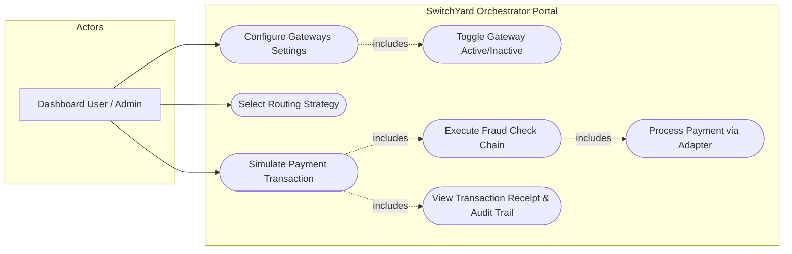
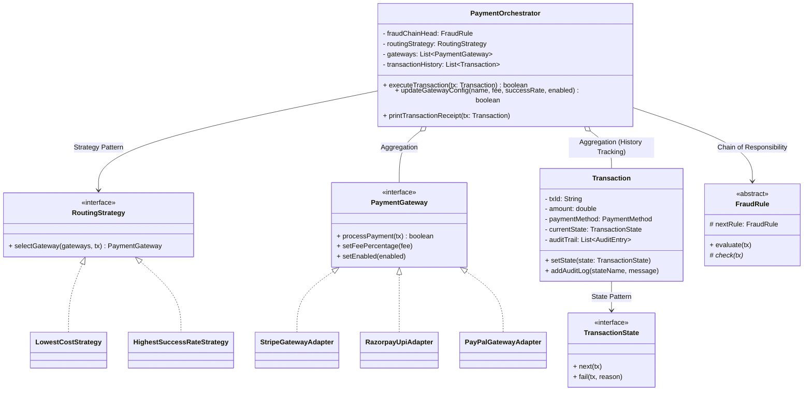
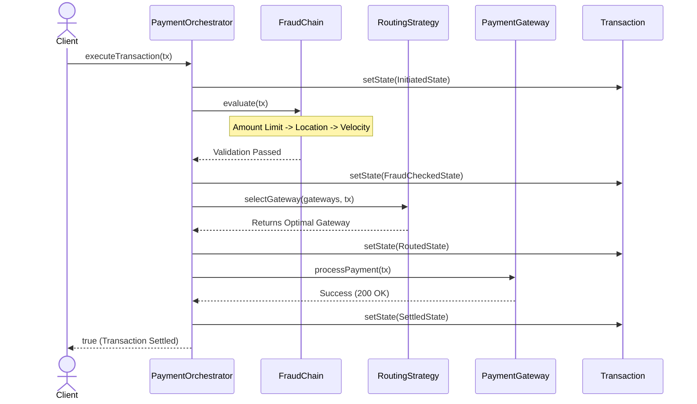
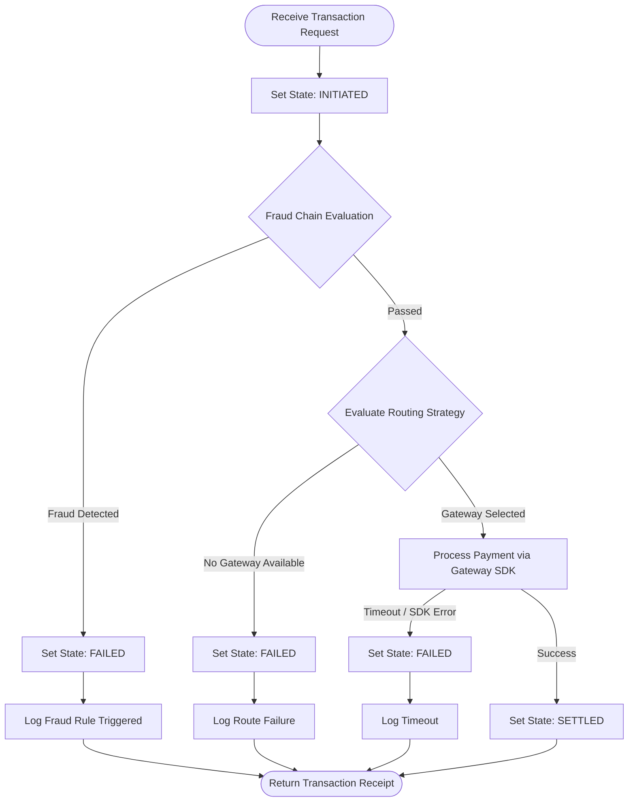

# SwitchYard: OOM Documentation & UML

# System Design Diagrams — Project SwitchYard

## 1. Use Case Diagram

## 2. Class Diagram

## 3. Sequence Diagram

## 4. Activity Diagram

## 5. OOM & Design Pattern Mapping Table

The following table explicitly maps core Object-Oriented methodologies, SOLID principles, and design patterns to the SwitchYard source code.

| Concept / Principle | Implementation in SwitchYard |
|---|---|
| **Encapsulation** | `Transaction` fields are strictly private. State transitions occur securely via `setState()`, and logs are appended exclusively via `addAuditLog()`. |
| **Inheritance** | Specific fraud rules (`AmountLimitFraudRule`, `VelocityCheckFraudRule`) extend the base `FraudRule` abstract class, inheriting its template execution flow. |
| **Polymorphism** | Calling `routingStrategy.selectGateway()` dynamically executes logic from either `LowestCostStrategy` or `HighestSuccessRateStrategy` based on user selection. |
| **Abstraction** | The `PaymentOrchestrator` relies entirely on the `PaymentGateway` interface, hiding the complex reality of dealing with distinct external payment SDKs. |
| **Composition** | `Transaction` strictly owns its internal `List<AuditEntry>`. If the transaction object is garbage-collected, the audit logs are destroyed with it. |
| **Aggregation** | `PaymentOrchestrator` aggregates `Transaction` history, and `Transaction` references `Customer`/`Merchant`. These objects are instantiated independently. |
| **SRP (SOLID)** | Single Responsibility Principle: `FraudRule` classes only validate fraud, `RoutingStrategy` classes only evaluate gateway selection, and `TransactionState` classes only handle lifecycle transitions. |
| **OCP (SOLID)** | Open/Closed Principle: To add a new Crypto gateway, developers create a new class implementing `PaymentGateway` and add it to the factory list without altering `PaymentOrchestrator`. |
| **LSP / ISP (SOLID)** | Liskov Substitution Principle: Any `PaymentGateway`, `RoutingStrategy`, or `FraudRule` subclass can replace another without breaking the orchestrator. Interface Segregation Principle: Small, focused interfaces like `TransactionState` and `RoutingStrategy`. |
| **DIP (SOLID)** | Dependency Inversion Principle: `PaymentOrchestrator` depends on abstractions (`RoutingStrategy`, `FraudRule`, `PaymentGateway`) rather than concrete classes, passed in via its constructor. |
| **Exception Handling** | `PaymentException` hierarchy with 4 subclasses. `PaymentOrchestrator.executeTransaction()` catches each, calls `.fail()`, and ensures `executionTimeMs` and history logging execute in the `finally` block. |
| **Strategy Pattern** | Enables hot-swapping routing logic dynamically at runtime without restarting the server or altering the orchestrator's core code. |
| **Chain of Responsibility** | `FraudChainFactory` sequentially links validation nodes. If any node throws an exception, the request is immediately halted and blocked. |
| **Template Method** | `FraudRule.evaluate()` is final: it executes `check()` and inherently handles forwarding to `nextRule`. Subclasses only need to implement the specific `check()` logic. |
| **Factory Pattern** | `GatewayFactory` and `FraudChainFactory` encapsulate the object creation logic, ensuring `ConsoleRunner` and `DashboardServer` never directly invoke concrete constructors. |
| **Adapter Pattern** | Standardizes incompatible mock SDKs (`RazorpayUpiSDK`, `StripeExternalSDK`) behind uniform `PaymentGateway` adapter shells. |
| **State Pattern** | Models the exact transaction lifecycle (`Initiated` -> `FraudChecked` -> `Routed` -> `Settled` / `Failed`), strictly governing directional flow. |